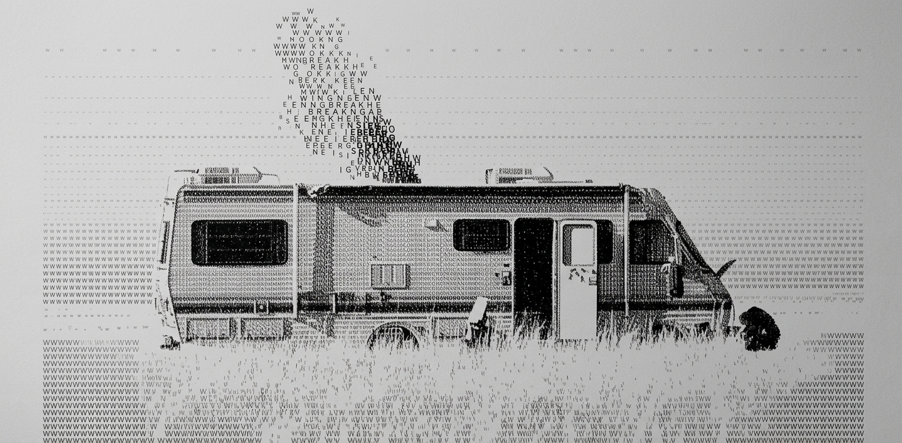

  

 

---

<table>
  <tr>
    <td width="65%" valign="middle">
      

        Me apasiona el desarrollo de software y la creación de soluciones
        tecnológicas que resuelven problemas reales.
      

      

        Me enfoco en el desarrollo web, la automatización de procesos y
        la construcción de sistemas que combinan funcionalidad, tecnología
        y buenas experiencias de usuario.
      

    </td>
    <td width="35%" align="center" valign="middle">
      
    </td>
  </tr>
</table>

---

<h2 align="center">🛠️ TECNOLOGÍAS</h2>

  

---

<h2 align="center">🚀 PROYECTOS</h2>

Algunos proyectos en los que he trabajado.

<table>
  <tr>
    <td width="50%" valign="top">
      <h3>🌱 AgroMind</h3>
      
Solución tecnológica orientada al sector agrícola.

      

        
        
      

      

        <a href="https://frontend-service-7zym.onrender.com/login">🔗 Ver proyecto</a>
      

    </td>
    <td width="50%" valign="top">
      <h3>🪟 ALANYA</h3>
      
Página web para presentar servicios de vidrio y aluminio.

      

        
        
        
      

      

        <a href="https://raul-alanya.github.io/pagina-web-vidrieria/">🔗 Ver página web</a>
      

    </td>
  </tr>
  <tr>
    <td width="50%" valign="top">
      <h3>💳 Microservicio de pagos</h3>
      

        Microservicio con Spring Boot para la integración de pagos
        en línea mediante Izipay.
      

      

        
        
        
        
      

      

        <a href="https://pagos.sistemas9noa.com/swagger-ui/index.html">📄 Documentación API</a>
      

    </td>
    <td width="50%" valign="top">
      <h3>📖 Sistema de gestión bibliotecaria</h3>
      

        Sistema web para gestionar el catálogo de libros, las búsquedas
        y los ejemplares de una biblioteca.
      

      

        
        
        
      

      
<strong>Proyecto académico</strong>

    </td>
  </tr>
</table>

---

<h2 align="center">📬 CONTACTO</h2>

  ¿Tienes una idea o proyecto en mente? ¡Hablemos!

  
  
  

  
<i>Un píxel a la vez. 🚀</i>

